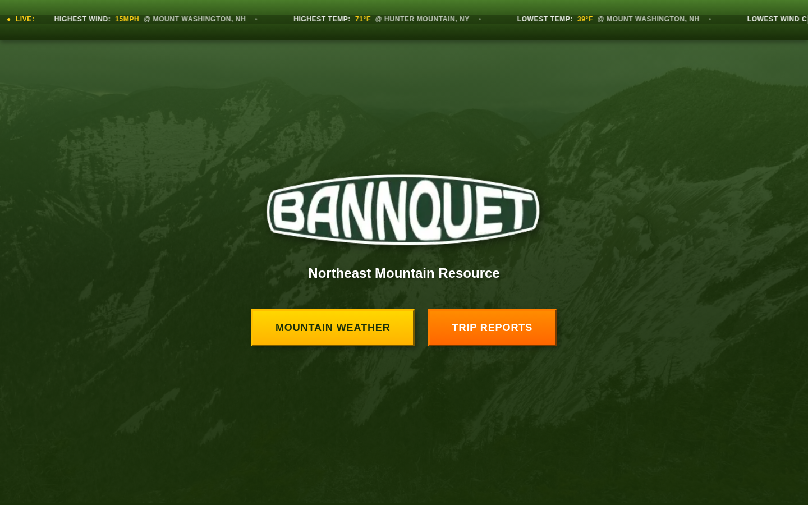

# Bannquet

Mountain weather and trip reports for the Northeast. Bannquet pulls National Weather Service forecasts for summits and valleys across the Adirondacks, Catskills, Shawangunks, Green Mountains, White Mountains and Maine, and keeps published trip reports for the crew.

Live at [bannquet.com](https://www.bannquet.com).



## What it does

- Hourly and daily forecasts, wind, precipitation and alerts for each mountain. Regions live in `config/weather-regions.json`, so adding a spot is a data change.
- A ticker at the top of the homepage showing the current extremes across those regions.
- `/stats` keeps the Adirondack 46 and the New Hampshire 48, plus miles, elevation, and summit leaderboards for foot, bike, and ski. The lists live in `config/challenges`. A route that passes within about 500 feet of a summit counts, and a friend can also mark a peak by hand. A finished list shows a small 88×31 badge on the stats page and on that person's profile.
- `/trips` is a light planner: a title, a date, a trailhead pin, an I'm-in toggle, the same NWS forecast used everywhere else, and a shared packing list. Templates for day hike, overnight, winter, bike, and ski live in `config/packing-templates.json`. A trip can point at posts afterward, and the trailhead shows on the group map.
- Published trip reports read from Postgres. Signed-in friends write a post (title, date, activity, tagged friends, story, photos, optional GPX) and it shows in the feed and on the group map.
- The group map uses MapLibre. Standard tiles are OpenFreeMap. Topo and satellite are USGS National Map. Hybrid keeps OpenFreeMap labels on the imagery. 3D terrain uses AWS Terrarium elevation tiles. None of these are paid map APIs.

More detail on the weather endpoints is in `API_DOCUMENTATION.md`.

## Stack

Next.js 16.3, React 19.2, TypeScript, Tailwind CSS 4, Framer Motion, Drizzle ORM, and Neon Postgres. Weather comes from the NWS API. Deployed on Vercel.

## Running it locally

You need Node.js 20 or newer.

```sh
npm install
npm run dev
```

Then open http://localhost:3000. Copy `.env.example` to `.env.local`.

Weather pages work with no keys. Trip reports stay empty until `DATABASE_URL` points at a Postgres database and the schema has been migrated. Reading the site stays public. Anyone can make an account at `/sign-up`. Until Jake approves them on `/admin`, they can sign in and read, but they cannot post or edit. An invite link from `/admin` still skips that wait. After that they sign in with email and password. `ADMIN_EMAIL` is the address that can sign in without an invite and is stored as admin. Sessions last a week and refresh when someone comes back, which is as long as Neon Auth keeps them. Photo uploads need `BLOB_READ_WRITE_TOKEN` from the Vercel Blob store.

## Database

`DATABASE_URL` is the pooled Neon connection (the host contains `-pooler`). `DATABASE_URL_UNPOOLED` is the direct connection Drizzle uses for migrations.

```sh
npm run db:generate   # write a new SQL migration from src/db/schema.ts
npm run db:migrate    # apply drizzle/ to DATABASE_URL_UNPOOLED
```

Run migrations against a Neon branch before production. The first migration enables PostGIS.

### Sanity import

`scripts/migrate-sanity-trip-reports.ts` copies existing `tripReport` documents into `trip_reports`, `photos`, and `pins`. It is not part of the site build, and it will not write unless you opt in.

```sh
npm run db:migrate-sanity -- --dry-run
CONFIRM_SANITY_MIGRATION=yes npm run db:migrate-sanity
```

The dry run only talks to Sanity. The real run needs `SANITY_PROJECT_ID`, `SANITY_API_TOKEN`, and `DATABASE_URL`. Set `BLOB_READ_WRITE_TOKEN` if images should be copied into Vercel Blob. Without it, photo rows keep the Sanity CDN URL.

Old `/trip-reports/<sanity-id>` links redirect to `/posts/<id>` after a report is imported. The public feed is `/posts`. Profile pages live at `/user/<username>`; `/hikers/<username>` redirects there.

## Scripts

- `npm run dev` starts the dev server
- `npm run build` builds for production
- `npm run start` serves the production build
- `npm run lint` runs ESLint
- `npm run typecheck` runs TypeScript
- `npm test` runs the small node tests

The live-conditions socket server for the user map is a separate project, [bannquet-io](https://github.com/jakedcl/bannquet-io).
