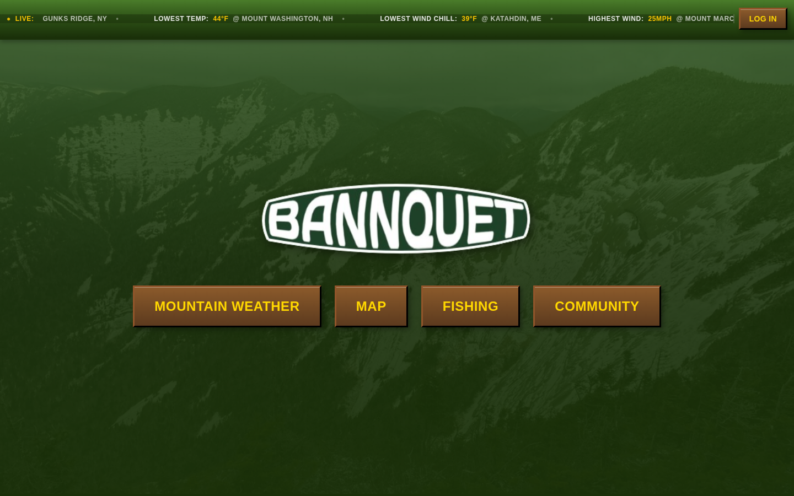

# Bannquet

Mountain weather and trip reports for the Northeast. Bannquet pulls National Weather Service forecasts for summits and valleys across the Adirondacks, Catskills, Shawangunks, Green Mountains, White Mountains and Maine, and keeps published trip reports for the crew.

Live at [bannquet.com](https://www.bannquet.com).



## What it does

- Hourly and daily forecasts, wind, precipitation and alerts for each mountain. Regions live in `config/weather-regions.json`, so adding a spot is a data change.
- A ticker at the top of the homepage showing the current extremes across those regions. The banner links to `/conditions`, which lists the same extremes and the spots behind them.
- `/fishing` has saltwater conditions (tides, water, wind, what's in season), freshwater rivers from USGS water data, stocking and guides.
- `/peaks` lists the Catskill 35, Adirondack 46, New Hampshire 48, Vermont 4000-footers, Maine 4000-footers, and the New England 67 as those three New England lists together. Each member keeps a simple "I've been here" list of peaks (no dates); a route upload that passes a peak not on their list asks "Add it to your peaks?" The lists live in `config/challenges`. A finished list shows a small 88x31 badge on that person's profile.
- `/trips` is a light planner: a title, a date, notes, an I'm-in toggle, attached pins, routes and photos, and a shared packing list. Templates for day hike, overnight, winter, bike, and ski live in `config/packing-templates.json`. Trips replaced posts, so `/posts` links redirect to `/trips`.
- `/community` links to chat, peaks, trips, members, gear and the map.
- `/chat` is one group chat. Messages can link a pin, route or photo.
- `/gear` is a shared gear list, and `/members` lists approved members.
- The map uses MapLibre. Standard tiles are OpenFreeMap. Topo and satellite are USGS National Map. Hybrid keeps OpenFreeMap labels on the imagery. 3D terrain uses AWS Terrarium elevation tiles. None of these are paid map APIs.

More detail on the weather endpoints is in `API_DOCUMENTATION.md`.

## Stack

Next.js 16, React 19, TypeScript, Tailwind CSS 4, Framer Motion, Drizzle ORM, and Neon Postgres. Weather comes from the NWS API. Deployed on Vercel.

## Running it locally

You need Node.js 20 or newer.

```sh
npm install
npm run dev
```

Then open http://localhost:3000. Copy `.env.example` to `.env.local`.

Weather pages work with no keys. Mountain fishing reads USGS water data without a key, on a low rate limit. Set `USGS_WATER_DATA_API_KEY` (or `WATER_DATA_API_KEY`) on Vercel for the higher limit. Trips, chat, gear and members stay empty until `DATABASE_URL` points at a Postgres database with the schema in place. Reading the site stays public. Anyone can make an account at `/sign-up`. Until Jake approves them on `/admin`, they can sign in and read, but they cannot post or edit. An invite link from `/admin` still skips that wait. After that they sign in with email and password. `ADMIN_EMAIL` is the address that can sign in without an invite and is stored as admin. Sessions last a week and refresh when someone comes back, which is as long as Neon Auth keeps them. Photo uploads need `BLOB_READ_WRITE_TOKEN` from the Vercel Blob store.

## Database

`DATABASE_URL` is the pooled Neon connection (the host contains `-pooler`). `DATABASE_URL_UNPOOLED` is the direct connection Drizzle uses for migrations.

`npm run db:generate` writes a new SQL migration from `src/db/schema.ts`. Don't run `npm run db:migrate` against the `main` database branch. Migrations from 0010 on were applied by hand, so it would try to replay them and fail. Follow `docs/environments.md` for how schema changes get applied.

Old `/trip-reports` and `/posts` links end up at `/trips`. Profile pages live at `/user/<username>`; `/hikers/<username>` redirects there.

## Scripts

- `npm run dev` starts the dev server
- `npm run build` builds for production
- `npm run start` serves the production build
- `npm run lint` runs ESLint
- `npm run typecheck` runs TypeScript
- `npm test` runs the small node tests

