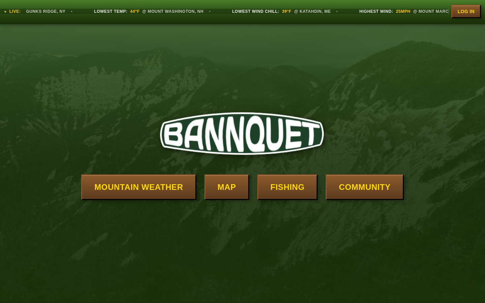

# Bannquet

[Bannquet](https://www.bannquet.com) is a Northeast hiking crew site: mountain weather for summits and trails, a trail map, fishing conditions, peak challenges, trip planning, photos, and community posts.



## Features

- **Mountain weather** (`/mountain-weather`) — hourly and daily NWS forecasts, wind, precip, and alerts for hundreds of places across New York, Vermont, New Hampshire, and Maine. Sections cover bulletins, observations, snow, avalanche outlooks, maps, and a Northeast conditions board. Data is attributed on-page and comes from free public sources: [NWS](https://www.weather.gov/), [Iowa Environmental Mesonet](https://mesonet.agron.iastate.edu/) local storm reports, state avalanche centers, USGS, AirNow, drought monitor, and other agency feeds wired in `src/lib/mountain-weather/`.
- **Conditions ticker** — homepage banner and `/mountain-weather/conditions` show live extremes from bound NWS stations (`config/weather-regions.json`).
- **Map** (`/map`) — MapLibre with OpenFreeMap, USGS topo/satellite, and AWS Terrarium terrain (no paid tile APIs).
- **Peak Finder** (`/peak-finder`) — browser-based summit skyline tool (static peak data, terrain in the client).
- **Peaks** (`/peaks`) — Catskill 35, Adirondack 46, NH 48, VT and ME 4000-footers, and combined New England lists (`config/challenges/`).
- **Trips & photos** — shared trip plans, routes, pins, and gallery (`/trips`, `/photos`, `/posts`; legacy `/posts` URLs redirect).
- **Fishing** (`/fishing`) — saltwater tides and marine conditions, USGS freshwater flows, stocking calendars, and guides.
- **Community** — members, gear list, and group chat for approved accounts.

Weather and fishing boards work without API keys. Member content needs Postgres and Vercel Blob for uploads.

API notes for the original region weather endpoints: `API_DOCUMENTATION.md`.

## Stack

- **App:** Next.js 16 (App Router), React 19, TypeScript, Tailwind CSS 4, Framer Motion
- **Data:** Neon Postgres, Drizzle ORM (PostGIS), self-hosted [Better Auth](https://www.better-auth.com/) with the Drizzle adapter (`neon_auth` schema)
- **Hosting:** Vercel (builds on push), Vercel Blob for photos
- **Maps:** MapLibre GL

## Run locally

Node.js 20+.

```sh
npm install
cp .env.example .env.local   # fill DATABASE_URL etc. for full features
npm run dev
```

Open [http://localhost:3000](http://localhost:3000).

`DATABASE_URL` should be the pooled Neon URL (`-pooler` host). Use `DATABASE_URL_UNPOOLED` for Drizzle migrations. Preview and local dev target the Neon `preview` branch; production uses `main`. See `docs/environments.md` before changing schema or auth.

New sign-ups can read the site; posting requires admin approval on `/admin` (invite links skip the wait). `ADMIN_EMAIL` lists admins.

## Scripts

| Command | Purpose |
|---------|---------|
| `npm run dev` | Dev server |
| `npm run build` | Production build |
| `npm run lint` | ESLint |
| `npm run typecheck` | TypeScript |
| `npm test` | Unit tests (tsx) |
| `npm run db:generate` | SQL from `src/db/schema.ts` |

Do not run `npm run db:migrate` against production `main`; migrations from 0010 onward are applied manually per `docs/environments.md`.

## License

See [LICENSE](LICENSE).